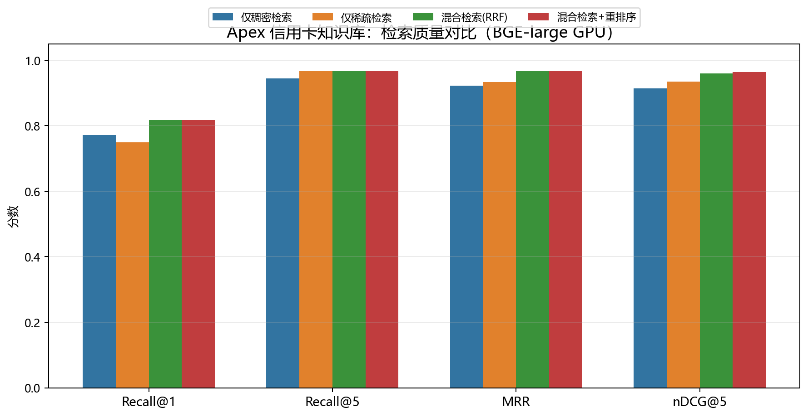
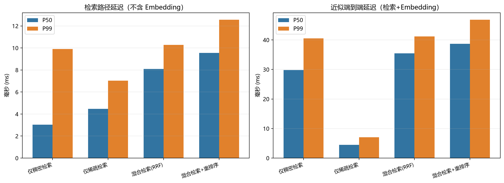
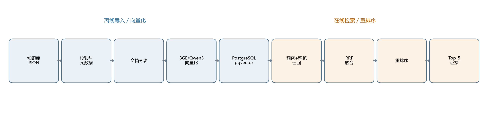

# Apex RAG 检索引擎（中文版）

面向 Apex Card Services 信用卡客服知识库的可复现混合检索与评测工程。项目重点在
**检索质量、排序效果和延迟**，而不是做一个只看起来会聊天的 Demo。

## 致评审人员

所有命令都在 `git clone` 后的仓库根目录执行。最短验证命令：

```powershell
git clone https://github.com/zsyzxcbnm/bxrag.git
cd bxrag
powershell -ExecutionPolicy Bypass -File .\scripts\reproduce.ps1
```

代码检查、完整 BGE GPU 和 Docker/API 验证见
[REVIEW.zh-CN.md](REVIEW.zh-CN.md)。

英文版见 [README.md](README.md)。

## 当前结果

当前主结果来自本地 **BGE-large-en-v1.5 + PostgreSQL/pgvector + CUDA GPU**：

| 管线 | Recall@1 | Recall@5 | MRR | nDCG@5 | 检索 P50 | 检索 P99 |
|---|---:|---:|---:|---:|---:|---:|
| 仅稠密检索 | 0.772 | 0.944 | 0.922 | 0.914 | 3.06 ms | 8.12 ms |
| 仅稀疏检索 | 0.750 | 0.967 | 0.933 | 0.935 | 2.83 ms | 4.57 ms |
| 混合检索 + RRF | 0.817 | 0.967 | 0.967 | 0.960 | 6.28 ms | 9.58 ms |
| 混合检索 + 重排序 | **0.817** | **0.967** | **0.967** | **0.964** | **7.68 ms** | **10.36 ms** |

GPU 上查询 Embedding 约 **25 ms P50 / 30 ms P99**，因此混合检索+重排序的近似
端到端延迟约为 **32 ms P50 / 40 ms P99**，已经低于 100ms。





## 中文报告

- [检索评测报告](reports/results.zh-CN.md)
- [分块策略对比](reports/chunking.zh-CN.md)
- [HNSW 索引参数扫描](reports/index_tuning.zh-CN.md)
- [Embedding 方案对比](reports/embedding_comparison.zh-CN.md)
- [重排序器对比](reports/reranker_comparison.zh-CN.md)
- [元数据规则消融](reports/ablation_metadata.zh-CN.md)
- [战略架构路线图](docs/roadmap.zh-CN.md)

重要消融结论：不做人工元数据规则、直接使用 RRF 的基线反而最好
（Recall@1 **0.850**、MRR **1.000**、nDCG@5 **0.994**）。卡种/年份硬过滤和
启发式规则是为这份 30 条数据设计的，应视为有调优偏差的方案。

## 架构



离线链路负责数据校验、元数据抽取、分块、向量化和索引构建；在线链路负责查询解析、
稠密/稀疏召回、RRF 融合、重排序和 Top-5 证据返回。

## 目录结构

```text
data/                       数据集和本地模型目录
docs/roadmap.zh-CN.md       中文战略架构路线图
reports/                    中文/英文评测报告和图表
src/ingestion/              加载、规范化、分块、Embedding
src/retrieval/              稠密、稀疏、RRF、重排序、检索流水线
src/eval/                   指标、实验、报告、索引调参
src/db.py                   PostgreSQL + pgvector
src/db_memory.py            离线验证用内存后端
tests/                      指标、融合、查询解析、分块测试
```

## 快速开始

### 1. 启动 PostgreSQL

```powershell
docker compose up -d db
.\scripts\setup.ps1
& '.\.venv\Scripts\python.exe' -m src.cli init-db
```

### 2. 使用 BGE + GPU 重建索引

所有项目依赖统一安装在项目内 `.venv`，不再往 系统 Anaconda 安装。
该环境包含 CUDA PyTorch：

```powershell
$env:EMBEDDING_PROVIDER='sentence-transformers'
$env:EMBEDDING_MODEL='data\models\bge-large-en-v1.5'
$env:EMBEDDING_DIM='1024'
$env:EMBEDDING_DEVICE='cuda'
$env:KMP_DUPLICATE_LIB_OK='TRUE'

& '.\.venv\Scripts\python.exe' -m src.cli reset-db --yes
& '.\.venv\Scripts\python.exe' -m src.cli ingest
& '.\.venv\Scripts\python.exe' -m src.cli eval `
  --dense-weight 0.5 --sparse-weight 0.5 --repeats 3
```

### 3. 无 Docker 的离线验证

```powershell
& '.\.venv\Scripts\python.exe' -m src.cli all --backend memory
```

离线后端使用内存 BM25 + cosine，只用于验证检索和评测逻辑；正式指标请使用
PostgreSQL/pgvector 后端。

## 配置与密钥

- `.env.example` 是本地开发模板，里面的 `apex/apex` 只用于 Docker 开发。
- `.env.production.example` 是生产模板，只包含占位符，不包含真实密码。
- 真实的 `.env`、数据库密码、API Key、私有模型路径不能提交到 Git；生产环境
  应通过部署平台或密钥管理服务注入。
- 配置由 `pydantic-settings` 统一读取，模型路径、数据库地址和检索参数都可以
  通过环境变量覆盖。
- CLI 有统一异常边界：业务配置/数据/存储错误会输出清晰错误并以非零状态退出，
  不会直接甩出完整堆栈。

## 一键复现

### 离线模式：不需要 Docker、GPU 或下载模型

```powershell
.\scripts\reproduce.ps1
```

如果安装了 `make`，等价命令是：

```text
make reproduce
```

脚本会自动创建/使用 `.venv`，用内存 BM25 + cosine 后端导入 150 条文档，
运行四条检索管线、Chunking 对比，并把中文图表写到 `reports/offline/`。

### 完整 PostgreSQL + BGE GPU

```powershell
.\scripts\reproduce.ps1 -Profile bge-gpu
```

等价的 Make 命令：

```text
make reproduce-gpu
```

完整测试和静态检查：

```text
make verify
```

Docker 部署路径也有对应 target：

```text
make docker-build
make docker-ingest
make docker-api
```

可选的 Judge 模型用 `make download-judge` 下载。

脚本会启动 pgvector 容器、重建 1024 维 BGE 索引、运行完整评测、HNSW 参数扫描、
元数据消融，并重新生成 `reports/` 下的中文图表。首次运行会自动下载缺失模型
（约 5GB，需要网络）；该 profile 需要 Docker 和 NVIDIA GPU。

两条命令都使用项目内 `.venv` 和项目内缓存/临时目录。
`requirements.txt` 只是 `pyproject.toml` 的便捷入口，依赖的权威定义仍在 `pyproject.toml`。

模型权重不提交到 Git。`docker compose up -d` 只启动 PostgreSQL，不会自动导入数据
或运行评测；请使用上面的一键脚本。

## Embedding 方案

项目支持三种 Embedding：

| 方案 | 说明 | 适用场景 |
|---|---|---|
| TF-IDF + SVD | 128 维，完全离线，速度最快 | 基线、无网络环境 |
| BGE-large-en-v1.5 | 1024 维，英文检索，GPU 约 25ms/query | 当前英文知识库首选 |
| Qwen3-Embedding-0.6B | 1024 维，语义能力强，CPU 较慢 | 多语言、中文、更强 Dense |

BGE 查询会自动加官方检索指令：

```text
Represent this sentence for searching relevant passages:
```

文档端不加指令。

## 常用命令

```text
& '.\.venv\Scripts\python.exe' -m src.cli init-db
& '.\.venv\Scripts\python.exe' -m src.cli ingest
& '.\.venv\Scripts\python.exe' -m src.cli eval --dense-weight 0.5 --sparse-weight 0.5
& '.\.venv\Scripts\python.exe' -m src.cli search "What is the balance transfer fee?"
& '.\.venv\Scripts\python.exe' -m src.cli compare-chunking
& '.\.venv\Scripts\python.exe' -m src.cli benchmark-index
& '.\.venv\Scripts\python.exe' -m src.cli ablation-metadata
& '.\.venv\Scripts\python.exe' -m src.cli judge
& '.\.venv\Scripts\python.exe' -m src.cli stats
```

Windows 也可以使用 `scripts/run.ps1`，例如：

```powershell
.\scripts\run.ps1 all
.\scripts\run.ps1 chunking
.\scripts\run.ps1 index-bench
.\scripts\run.ps1 ablation
.\scripts\run.ps1 judge
```

## FastAPI / OpenAPI

API 通过 `api` compose profile 启动：

```powershell
docker compose --profile api up -d --build
```

首次部署需要导入数据，否则 API 能启动但数据库是空的：

```powershell
docker compose --profile api build api
docker compose --profile api run --rm api python -m src.cli ingest
docker compose --profile api up -d api
```

访问：

- Swagger UI：`http://localhost:8000/docs`
- OpenAPI JSON：`http://localhost:8000/openapi.json`
- 健康检查：`http://localhost:8000/healthz`

示例：

```powershell
$body = @{ query = "balance transfer fee"; top_k = 5; mode = "hybrid"; use_metadata = $false } |
  ConvertTo-Json
Invoke-WebRequest -Uri http://localhost:8000/api/v1/search -Method Post `
  -ContentType application/json -Body $body
```

API 启动时只加载一次 Embedding 模型，数据库连接复用；支持 `dense_only`、
`sparse_only`、`hybrid` 和 `hybrid_rerank`。compose 默认以只读方式挂载
`./data/models`，使用 CPU BGE；如需 GPU，设置 `EMBEDDING_DEVICE=cuda` 并配置
Docker GPU 支持。

## LLM-as-a-Judge

`python -m src.cli judge` 会用规则无关的 Hybrid RRF 取 Top-5 证据，让本地
`Qwen2.5-0.5B-Instruct` 生成带引用的简短答案，再评估 Context Relevance 和
Faithfulness。0.5B 小模型只适合做流程冒烟测试：Context Relevance 容易饱和，
30 条查询中有 2 次 JSON 解析失败。结果见
[llm_judge.zh-CN.md](reports/llm_judge.zh-CN.md)。

## 重排序器

默认使用元数据感知的启发式重排序。`bge-reranker-large` 也已接入：

- 模型位置：`data\models\bge-reranker-large`
- GPU fp16 显存约 1.1GB
- 在本数据集上 Recall@1/MRR 与启发式持平，但 nDCG@5 略低，P50 约慢 20 倍
- 因此保留为可选 Cross-Encoder 能力，默认不启用

详细对比见 [重排序器对比](reports/reranker_comparison.zh-CN.md)。

## 数据特点

- 150 条信用卡政策片段，10 个业务分类，4 个卡种。
- 30 条客服问题；23 条只有 1 个相关文档，1 条有 2 个，6 条有 3 个。
- 文档中位数约 282 字符，已经接近单条 chunk，不适合过度切分。
- Policy Code 不唯一，34 个 Code 被多条文档共用，不能做主键。
- 分类字段存在噪声，因此只做软加权，不做硬过滤。
- 部分通用问题的标注不完整，严格指标会低估真实检索质量。

## 评测说明

- 指标：Recall@K、Precision@K、MRR、nDCG@K、P50/P99。
- 报告把“检索路径延迟”和“Embedding 延迟”分开，避免把 CPU/GPU 推理混入数据库延迟。
- 端到端延迟是两者百分位相加的近似值，不是严格的联合分布。
- HNSW 参数扫描结论：150 条数据下所有配置 Recall@10 都是 1.000，默认
  `m=16 / ef_construction=64 / ef_search=80` 性价比最高。

## 已知限制

- 当前评测集很小，不能直接外推到 10M 文档。
- 默认重排序器是启发式规则；可切换为 Cross-Encoder。
- 当前主结果使用本地 BGE GPU，模型文件约 1.3GB 权重，不提交到 Git。
- GPU 环境是独立 venv，生产部署应使用 CUDA/ONNX/TEI 服务化方案。

