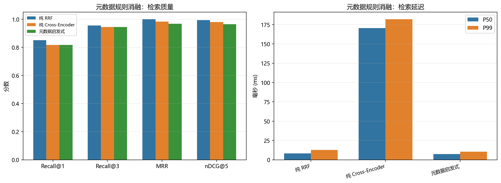

# 元数据规则消融实验（中文版）

本实验把三个因素拆开：

- `纯 RRF`：稠密 + 稀疏混合检索后直接 RRF，不做卡种/年份过滤，不做人工重排序。
- `纯 Cross-Encoder`：同样的混合检索，之后只使用 BGE Cross-Encoder，不融合人工元数据规则。
- `元数据启发式`：当前默认方案，包含卡种/年份过滤和人工启发式重排序。

| 管线 | Recall@1 | Recall@3 | MRR | nDCG@5 | 检索 P50 | 检索 P99 |
|---|---:|---:|---:|---:|---:|---:|
| 纯 RRF | **0.850** | **0.956** | **1.000** | **0.994** | **8.29 ms** | 12.82 ms |
| 纯 Cross-Encoder | 0.817 | 0.944 | 0.983 | 0.979 | 170.62 ms | 182.04 ms |
| 元数据启发式 | 0.817 | 0.944 | 0.967 | 0.964 | 7.54 ms | **10.55 ms** |

## 结论

- **纯 RRF 是当前 30 条查询上的最佳方案**：Recall@1 0.850、MRR 1.000、nDCG@5 0.994。
- 卡种/年份硬过滤和人工启发式在这份小规模、跨卡种数据上反而会过滤掉正确候选。
- 纯 Cross-Encoder 的排序质量优于元数据启发式（MRR 0.983 vs 0.967，nDCG@5 0.979 vs 0.964），但检索延迟约 170ms，远高于 RRF。
- 纯 Cross-Encoder 仍未超过纯 RRF。

建议把元数据从“默认硬过滤”改为“软加权或低置信度兜底”，并保留纯 RRF
作为无人工规则基线。启发式和 Cross-Encoder 继续作为可选重排序器。

