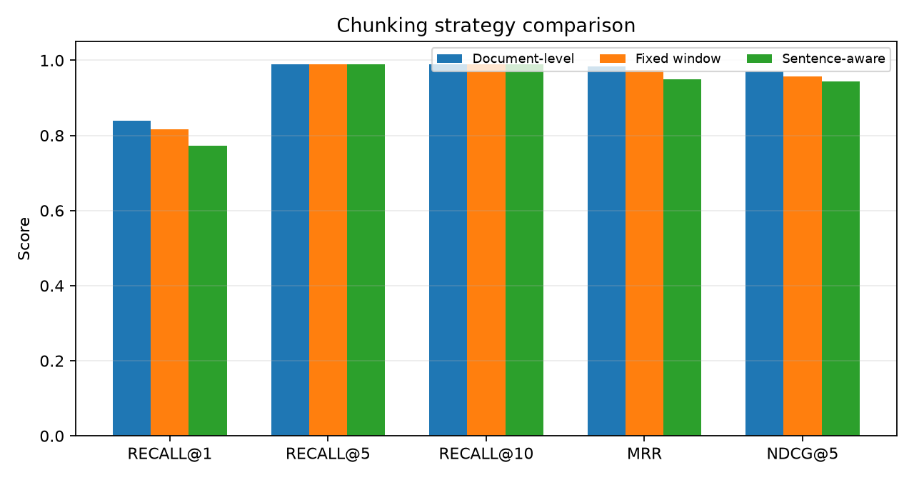

# Chunking Strategy Comparison

This comparison holds the retrieval stack fixed and changes only the chunking
strategy. It uses the in-memory backend with `data\models\bge-large-en-v1.5` and
metadata rules disabled, so every strategy runs under identical conditions.
Each strategy returns **10** documents. `Sentence-aware` packs
complete sentences into a maximum character budget and repeats document
metadata in each chunk; it is not embedding-based semantic segmentation.

| Strategy | Chunks | Avg tokens | Recall@1 | Recall@5 | Recall@10 | MRR | nDCG@5 | P50 (ms) | P99 (ms) |
|---|---:|---:|---:|---:|---:|---:|---:|---:|---:|
| Document-level | 150 | 47.3 | 0.839 | 0.989 | 0.989 | 0.983 | 0.970 | 24.79 | 36.62 |
| Fixed window | 282 | 29.9 | 0.817 | 0.989 | 0.989 | 0.975 | 0.957 | 23.54 | 30.19 |
| Sentence-aware | 163 | 49.9 | 0.772 | 0.989 | 0.989 | 0.950 | 0.944 | 23.32 | 32.44 |

## Interpretation

The supplied documents are already short (median 282 characters). Document-level chunking is at least as good as sentence-aware chunking and leads by Recall@1 +0.067, MRR +0.033, nDCG@5 +0.026. Fixed-window chunking is weaker than document-level chunking (document minus fixed: Recall@1 +0.022, MRR +0.008, nDCG@5 +0.013). Document-level chunking remains the simplest defensible default on this corpus.

The strategies remain in the repository so the choice is measured rather than
assumed, and can be repeated after the corpus grows into longer policy
documents.
