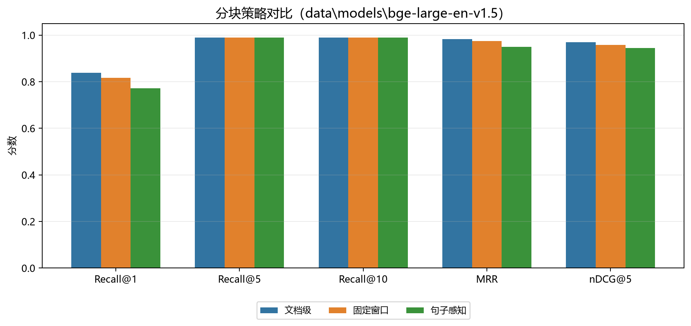

# 分块策略对比（中文版）

本实验固定检索栈，只改变分块策略；使用同一离线 Memory Backend、
`data\models\bge-large-en-v1.5` 和关闭元数据规则的配置，保证条件一致。
每种策略返回 **10** 条结果。
“句子感知”会按完整句子和字符上限打包 chunk，并在每个 chunk 前重复文档元数据；
它不是基于 embedding 的语义聚类，也不是标题层级切分。

| 策略 | Chunk 数 | 平均 token | Recall@1 | Recall@5 | Recall@10 | MRR | nDCG@5 | P50 | P99 |
|---|---:|---:|---:|---:|---:|---:|---:|---:|---:|
| 文档级 | 150 | 47.3 | 0.839 | 0.989 | 0.989 | 0.983 | 0.970 | 24.79 ms | 36.62 ms |
| 固定窗口 | 282 | 29.9 | 0.817 | 0.989 | 0.989 | 0.975 | 0.957 | 23.54 ms | 30.19 ms |
| 句子感知 | 163 | 49.9 | 0.772 | 0.989 | 0.989 | 0.950 | 0.944 | 23.32 ms | 32.44 ms |

## 结论

提供的文档本身已经较短（字符数中位数 282）。文档级切分不弱于句子感知切分，并在以下指标上领先：Recall@1 +0.067, MRR +0.033, nDCG@5 +0.026。固定窗口切分弱于文档级（文档级减固定窗口：Recall@1 +0.022, MRR +0.008, nDCG@5 +0.013）。当前语料下，文档级仍是最简单、最稳妥的默认策略。

英文版见 [chunking.md](chunking.md)。
