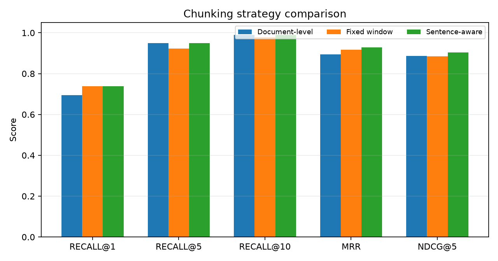

# Chunking Strategy Comparison

This comparison holds the retrieval stack fixed and changes only the chunking
strategy. It uses the in-memory backend with `local-tfidf-svd` and
metadata rules disabled, so every strategy runs under identical conditions.
Each strategy returns **10** documents. `Sentence-aware` packs
complete sentences into a maximum character budget and repeats document
metadata in each chunk; it is not embedding-based semantic segmentation.

| Strategy | Chunks | Avg tokens | Recall@1 | Recall@5 | Recall@10 | MRR | nDCG@5 | P50 (ms) | P99 (ms) |
|---|---:|---:|---:|---:|---:|---:|---:|---:|---:|
| Document-level | 150 | 47.3 | 0.694 | 0.950 | 0.989 | 0.894 | 0.886 | 5.33 | 5.88 |
| Fixed window | 282 | 29.9 | 0.739 | 0.922 | 0.978 | 0.917 | 0.885 | 5.43 | 5.94 |
| Sentence-aware | 163 | 49.9 | 0.739 | 0.950 | 0.989 | 0.928 | 0.903 | 5.19 | 6.46 |

## Interpretation

The supplied documents are already short (median 282 characters). Sentence-aware chunking is the stronger strategy in this run (Recall@1 +0.044, MRR +0.033, nDCG@5 +0.017 versus document-level). The measured gain is large enough to justify the extra chunks. Fixed-window chunking does not lose uniformly: document minus fixed is Recall@1 -0.044, MRR -0.022, nDCG@5 +0.001. Sentence-aware chunking is the better measured default for this corpus.

The strategies remain in the repository so the choice is measured rather than
assumed, and can be repeated after the corpus grows into longer policy
documents.
