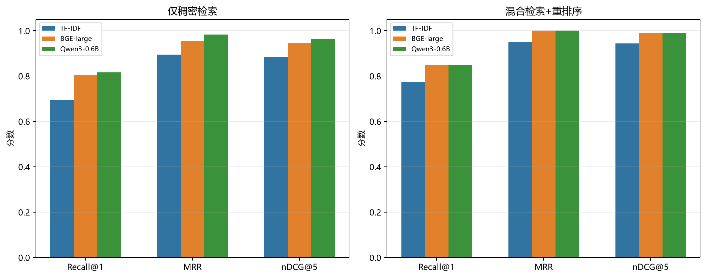

# Embedding 方案对比（中文版）

三组实验使用相同的 150 条文档、30 条查询、PostgreSQL/pgvector、0.5/0.5 的
RRF 权重，关闭元数据规则，并且每条查询真实返回 10 条结果；只替换 Embedding。

| Embedding | Dense R@1 | Dense MRR | Hybrid R@1 | Hybrid MRR | Hybrid nDCG@5 | Rerank R@1 | Rerank MRR | Rerank nDCG@5 |
|---|---:|---:|---:|---:|---:|---:|---:|---:|
| TF-IDF + SVD | 0.694 | 0.894 | 0.750 | 0.950 | 0.939 | 0.772 | 0.950 | 0.943 |
| BGE-large-en-v1.5 | 0.806 | 0.956 | **0.850** | **1.000** | **0.994** | **0.850** | **1.000** | 0.991 |
| Qwen3-Embedding-0.6B | **0.817** | **0.983** | 0.817 | 0.983 | 0.981 | **0.850** | **1.000** | 0.991 |

## 延迟

| 方案 | Query Embedding P50 | Hybrid 检索 P50 | 近似端到端 P50 |
|---|---:|---:|---:|
| TF-IDF + SVD | 2.61 ms | 7.25 ms | 9.86 ms |
| BGE-large CUDA | 27.34 ms | 8.10 ms | 35.44 ms |
| Qwen3-0.6B CUDA | 69.57 ms | 9.93 ms | 79.50 ms |

## 结论

- 两个神经 Embedding 都明显优于 TF-IDF 基线。
- BGE 在默认 rules-free Hybrid RRF 上最强（Recall@1 0.850，MRR 1.000，nDCG@5 0.994）。
- Qwen3 的 Dense-only 更强；加上可选启发式重排序后，两者 Recall@1、MRR 和
  nDCG@5 打平（nDCG@5 均为 0.991）。
- 在当前英文信用卡政策库上，推荐 BGE-large + CUDA：默认检索质量最好，且在同一
  GPU 上比 Qwen3 的查询 Embedding 更快。

英文版见 [embedding_comparison.md](embedding_comparison.md)。
