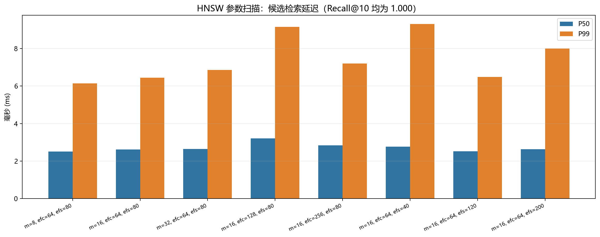

# HNSW 索引参数扫描（中文版）

## 实验配置

- Embedding：BGE-large-en-v1.5（1024 维）
- 查询数：30
- 每查询重复：3 次
- 召回参考：对全部 150 条向量做 NumPy cosine 精确 Top-10
- 索引扫描通过 `enable_seqscan=off` 强制走 HNSW
- 延迟只统计候选检索，不包含 query embedding

| m | ef_construction | ef_search | 构建时间 | 索引大小 | Recall@10 | P50 | P99 |
|---:|---:|---:|---:|---:|---:|---:|---:|
| 8 | 64 | 80 | 24.3 ms | 1208 kB | 1.000 | 2.50 ms | 6.14 ms |
| 16 | 64 | 80 | 27.7 ms | 1208 kB | 1.000 | 2.62 ms | 6.45 ms |
| 32 | 64 | 80 | 41.9 ms | 1208 kB | 1.000 | 2.65 ms | 6.86 ms |
| 16 | 128 | 80 | 28.6 ms | 1208 kB | 1.000 | 3.21 ms | 9.16 ms |
| 16 | 256 | 80 | 30.4 ms | 1208 kB | 1.000 | 2.84 ms | 7.20 ms |
| 16 | 64 | 40 | 38.0 ms | 1208 kB | 1.000 | 2.77 ms | 9.31 ms |
| 16 | 64 | 120 | 26.4 ms | 1208 kB | 1.000 | 2.52 ms | 6.48 ms |
| 16 | 64 | 200 | 26.7 ms | 1208 kB | 1.000 | 2.64 ms | 8.00 ms |

## 结论

- 所有配置 Recall@10 都是 1.000，说明 150 条数据远未触及 HNSW 的容量边界。
- 所有配置 P50/P99 都远低于 100ms；参数变化主要影响构建时间和索引内存。
- `m=32` 只增加构建时间，没有质量收益。
- `ef_search` 从 40 提到 200 没有稳定收益，默认 80 即可。
- 默认使用 `m=16`、`ef_construction=64`、`ef_search=80`。
- 这些结论只适用于当前小数据集；10M 级别必须在真实规模上重新测召回、构建内存和 P99。

英文版见 [index_tuning.md](index_tuning.md)。

