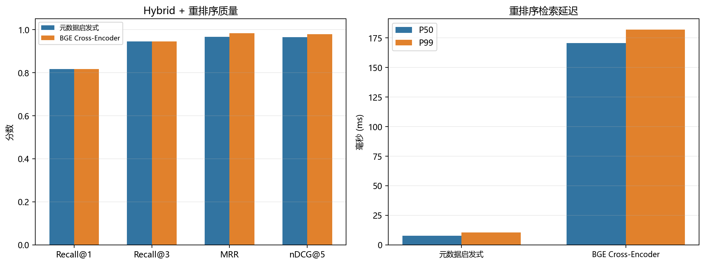

# Reranker Comparison: Metadata Heuristic vs BGE Cross-Encoder

## Setup

- Embedding: BGE-large-en-v1.5, CUDA
- Rerank candidates: 20
- Queries: 30, repeats: 3
- Cross-Encoder: `bge-reranker-large`, CUDA fp16, pure score (no metadata blend)
- Metadata heuristic: card-tier, answer-type, year and business-context rules

| Reranker | Recall@1 | Recall@3 | MRR | nDCG@5 | Retrieval P50 | Retrieval P99 |
|---|---:|---:|---:|---:|---:|---:|
| Metadata heuristic | **0.817** | **0.944** | 0.967 | 0.964 | **7.54 ms** | **10.55 ms** |
| BGE Cross-Encoder (pure) | **0.817** | **0.944** | **0.983** | **0.979** | 170.62 ms | 182.04 ms |



The Cross-Encoder P50 is about 170 ms, roughly 20x the heuristic path.

## Conclusion

`bge-reranker-large` loads and runs correctly on the 4GB GPU in fp16 (about
1.1GB of model memory). In pure mode it improves ranking quality over the
metadata heuristic:

- MRR rises from 0.967 to 0.983.
- nDCG@5 rises from 0.964 to 0.979.
- Retrieval P50 rises from about 8 ms to about 170 ms.

However, the rules-free RRF baseline is still stronger on this particular
30-query set (Recall@1 0.850, MRR 1.000, nDCG@5 0.994). See
`ablation_metadata.md`.

The likely reason is that hard card-tier/year filtering removes useful
candidates, while the Cross-Encoder can compare the query and passage more
flexibly. A simple 65/35 blend with the heuristic actually reduced nDCG@5 to
0.961, so pure Cross-Encoder scoring is the better control.

The production default therefore remains the heuristic reranker. The
Cross-Encoder is kept as an optional provider for larger or more semantic
corpora, and as evidence that the pipeline can integrate a real second-stage
model.

## Reproduce

```powershell
$env:RERANKER_PROVIDER='cross-encoder'
$env:RERANKER_MODEL='data\models\bge-reranker-large'
$env:RERANKER_DEVICE='cuda'
$env:RERANKER_FP16='true'

& '.\.venv\Scripts\python.exe' -m src.cli eval `
  --dense-weight 0.5 --sparse-weight 0.5 --repeats 3
```

