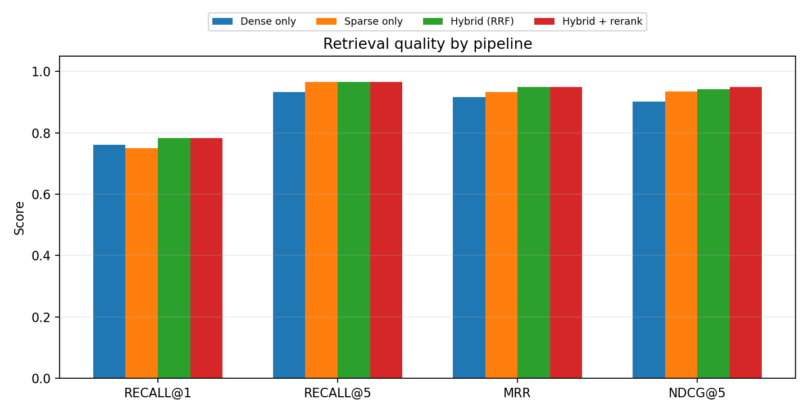
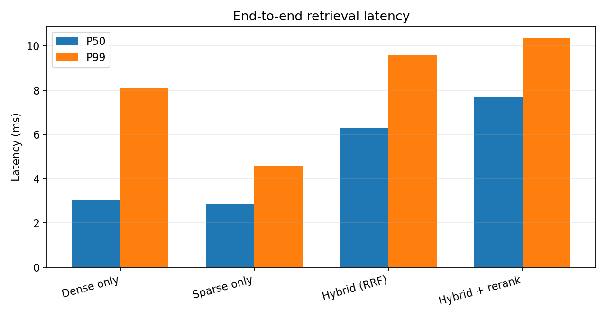

# Apex RAG Retrieval Evaluation

Generated at `2026-10-19T13:21:59.876866+00:00`.

## Setup

- Queries: **30**
- Storage backend: `postgres`
- Embedding: `G:\博贤\data\models\bge-large-en-v1.5` (1024 dimensions)
- Embedding provider: `sentence-transformers`
- Embedding device: `cuda:0`
- Reranker: `heuristic`
- RRF `k`: **60**
- RRF weights: dense **0.5**, sparse **0.5**
- Rerank candidates: **20**

The configured embedding provider and metadata-aware heuristic reranker are
recorded above so the run is reproducible. The OpenAI embedding and
Sentence-Transformers Cross-Encoder providers can be enabled through `.env`.

## Results

| Pipeline | Recall@1 | Recall@3 | Recall@5 | Precision@5 | MRR | nDCG@5 | P50 (ms) | P99 (ms) |
|---|---:|---:|---:|---:|---:|---:|---:|---:|
| Dense only | 0.772 | 0.889 | 0.944 | 0.267 | 0.922 | 0.914 | 3.06 | 8.12 |
| Sparse only | 0.750 | 0.922 | 0.967 | 0.280 | 0.933 | 0.935 | 2.83 | 4.57 |
| Hybrid (RRF) | 0.817 | 0.922 | 0.967 | 0.280 | 0.967 | 0.960 | 6.28 | 9.58 |
| Hybrid + rerank | 0.817 | 0.944 | 0.967 | 0.280 | 0.967 | 0.964 | 7.68 | 10.36 |

The table's P50/P99 columns measure the retrieval path (query embedding excluded):
vector search, sparse search, fusion and reranking. Query-embedding latency is
reported separately because it depends on the model and device:

| Pipeline | Embedding P50 (ms) | Embedding P99 (ms) |
|---|---:|---:|
| Dense only | 20.60 | 28.88 |
| Sparse only | 0.00 | 0.00 |
| Hybrid (RRF) | 27.38 | 31.12 |
| Hybrid + rerank | 24.65 | 30.02 |

Approximate end-to-end latency (retrieval + embedding percentiles; this is a
sum of percentiles, not a joint distribution):

| Pipeline | Approx. end-to-end P50 (ms) | Approx. end-to-end P99 (ms) |
|---|---:|---:|
| Dense only | 23.66 | 37.00 |
| Sparse only | 2.83 | 4.57 |
| Hybrid (RRF) | 33.66 | 40.70 |
| Hybrid + rerank | 32.33 | 40.38 |

## What the comparison shows

- Dense-only is the required baseline; sparse-only isolates the value of exact
  lexical matching on policy numbers, product names and time limits.
- Hybrid retrieval uses Reciprocal Rank Fusion over dense and PostgreSQL
  full-text candidates.
- Sparse query terms are OR-ed before `ts_rank_cd`; strict AND semantics
  produced near-zero recall on long natural-language questions.
- Hybrid + rerank applies a second-stage scorer to the top candidates and
  returns the final top 5.
- Recall@10 is deliberately not the headline metric: with 150 short documents
  and multi-label relevance it saturates quickly. Recall@1, MRR and nDCG@5 are
  the discriminating metrics.

## Index verification

The PostgreSQL schema contains `idx_chunks_embedding_hnsw` (HNSW, cosine) and
`idx_chunks_fts` (GIN). Dense retrieval is split into an HNSW candidate query
and a separate document-metadata fetch; this prevents the planner from doing a
full scan plus sort just to join product metadata. The HNSW sweep in
`index_tuning.md` reports Recall@10 **1.000** for every tested configuration,
with candidate-search P50 around **2.5 ms** and P99 around **7-8 ms**. All
tested `m`, `ef_construction` and `ef_search` values remain far below 100 ms;
`m=16`, `ef_construction=64`, `ef_search=80` is the default.

## Failure analysis

Queries where hybrid + rerank moved the first relevant document upward:

- Q-009: rank 3 -> 1 — What is the daily cutoff time for submitting payments on time?
- Q-025: rank 3 -> 1 — What happens if a provisional credit investigation resolves in favor of the merchant?

Queries where hybrid + rerank moved the first relevant document downward:

- None in this run.

The dominant error mode in this dataset is card-tier confusion: the same policy exists for several products with slightly different numbers. Metadata-aware reranking is therefore more valuable than generic semantic similarity.

A second issue is label exhaustiveness. For generic questions the judgment often lists only one or two card tiers even when another tier's policy contains the same fact. For example, DOC-0023 for Q-005 and DOC-0053 for Q-011 are semantically valid but not labeled relevant. Strict Recall/MRR therefore understates retrieval quality; it should not be tuned away by overfitting to the 30 labeled queries.

## Reproducibility and limitations

- All labels come from `data/eval_queries.json`; no judge or generated answer
  is used for the retrieval metrics.
- This is a small synthetic benchmark. Hyperparameters are global, not tuned
  per query.
- Dense quality depends on the selected embedding model. The local LSA
  embedding is an offline fallback; Qwen3/OpenAI embeddings can be selected
  through the provider configuration. BGE-large uses its retrieval query prefix.
- End-to-end latency includes query embedding and reranking; database-only
  latency is reported separately in the raw JSON.
